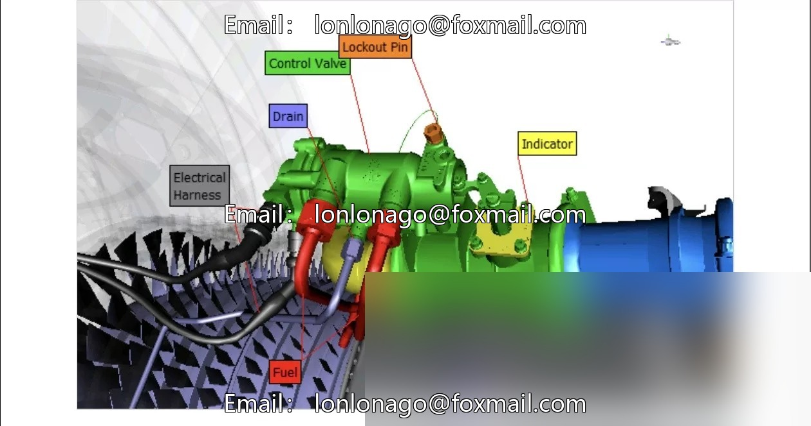
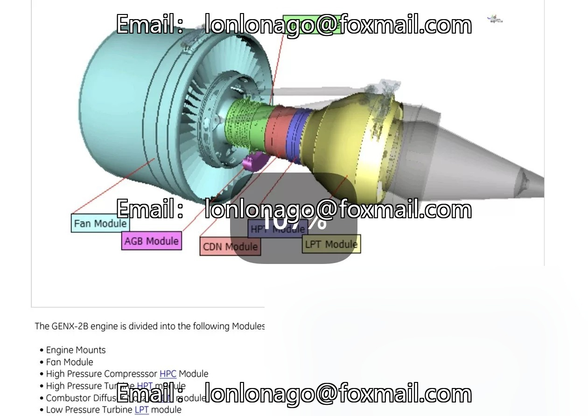
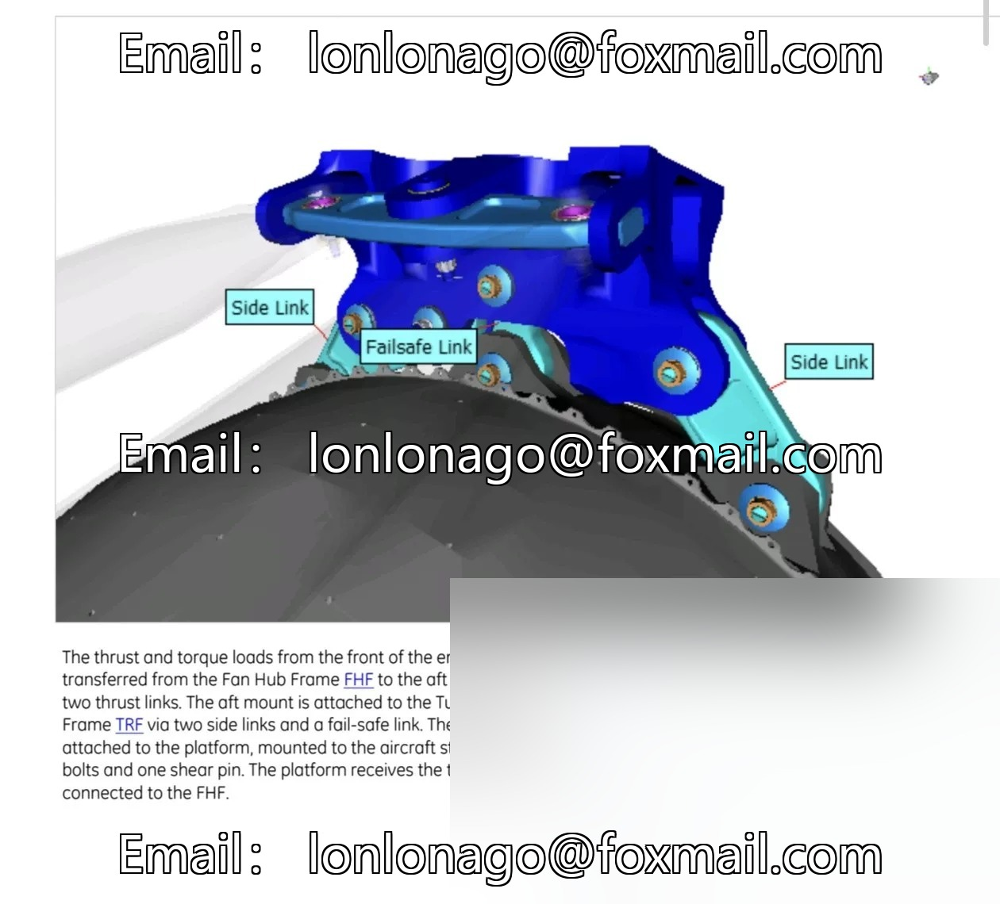

# GE Aviation GEnx-2B route maintenance course document (GE)

## Body

GE Aviation GEnx-2B route maintenance course document (GEK 117457, March 2010) PDF, 440 pages.
Content covers GEnx-2B engine route maintenance training, suitable for maintenance personnel to study.
returned upon sale.
GE Aviation's GEnx-2B route maintenance course document (GEK 117457, March 2010).
Core content involves route maintenance training for GEnx-2B engines.
The GEnx-2B is a high bypass ratio turbofan engine produced by General Electric Aviation, mainly used for aircraft such as Boeing 747-8, route maintenance includes daily inspection, fault exclusion, and basic repair, to ensure aircraft airworthiness.

Document table of contents shows that the courses cover modules such as engine overview, specifications, and recognition, applicable to maintenance personnel training.
Please note that the document contains GE proprietary information, which is subject to ITAR/EAR export controls, and must not be copied or disseminated without authorization.

The document covers GE Aviation GEnx-2B engine route maintenance training, including engine overview, specifications, recognition, and wing aft mounts, failsafe links, thrust and torque load transfer, and the 107% Fan Module and HPC Module.

<!-- AI_ENRICHED -->

## Images

## Payment

Here is a pay link on Stripe ( https://buy.stripe.com/3cs8yP7sY87d0vu9AB ). Please contact me lonlonago@foxmail.com after funding $89, and I will send you a complete data files , thank you!

